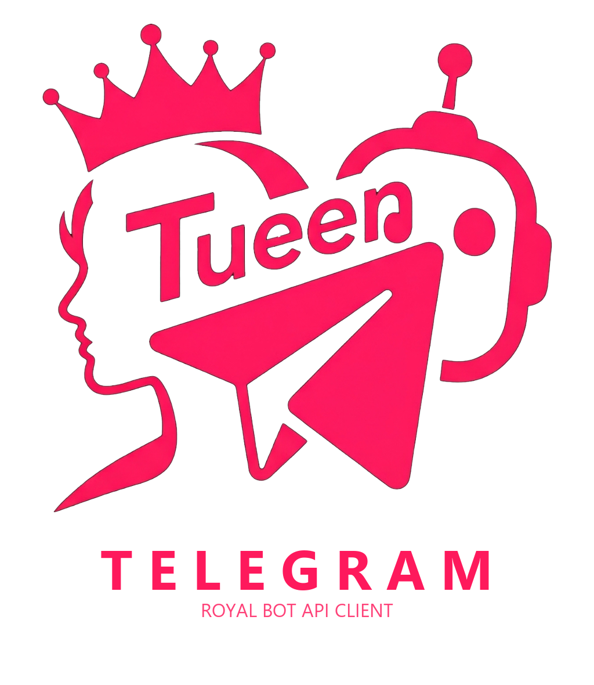

<p align="center">
  <a href="https://tueen.github.io/telegram/">
    
  </a>
</p>

<h1 align="center">Tueen Telegram 👑</h1>

<p align="center">
  <strong>The Royal Telegram Bot SDK for Modern PHP</strong><br>
  <em>Part of the Tueen ecosystem — "The Queen of Telegram"</em>
</p>

<p align="center">
  <a href="https://php.net"></a>
  <a href="https://core.telegram.org/bots/api"></a>
  <a href="https://github.com/tueen/telegram/actions/workflows/ci.yml"></a>
  <a href="https://tueen.github.io/telegram/"></a>
  <a href="https://tueen.github.io/telegram/llms.html"></a>
  <a href="LICENSE.md"></a>
</p>

---

## ⚡ Highlights

- 👑 **Complete Bot API Coverage** — Strictly-typed methods, models, and enums for all Telegram features.
- 💎 **Modern PHP 8.4+ Architecture** — Built with property hooks, asymmetric visibility, and zero legacy baggage.
- 🧭 **Expressive Routing** — Commands, callback queries, regex matchers, and PHP 8 attribute controllers.
- ⌨️ **Fluent Keyboards & Safe Formatting** — Intuitive Inline/Reply builders and entity-safe HTML/MarkdownV2 styling.
- 💬 **Conversational Flows & Navigation** — Multi-step state machines, hierarchical screen stacks, and zero-flicker UI transitions.
- 🔄 **Production Webhook & Polling** — Secret token validation and persistent worker support (FrankenPHP, Swoole, RoadRunner).
- 🚀 **Zero-Config App & Web Dashboard** — Instant bot launcher with a CLI toolkit and an embedded management dashboard.
- 🔌 **Resilient HTTP Pipeline** — Persistent connection pooling, automatic rate-limit backoff, and PSR-3 logging.
- 🛡️ **Dual Error Modes** — Choose between traditional exceptions or typed error objects with universal status checks.
- 🧪 **In-Memory Testing** — First-class testing fakes with expressive assertions and zero HTTP overhead.

---

## 📦 Requirements & Installation

- **PHP 8.4** or higher (fully compatible with PHP 8.5+)
- **Composer 2.x**
- Extensions: `json`, `curl` or stream wrappers, `mbstring`

```bash
composer require tueen/telegram
```

---

## 🚀 Quickstart

### 1. Interactive Command & Callback Bot

Build an interactive bot with command routing, inline buttons, and safe HTML formatting:

```php
<?php

declare(strict_types=1);

use Tueen\Telegram\Telegram;
use Tueen\Telegram\Types\User;
use Tueen\Telegram\Types\Update;
use Tueen\Telegram\Keyboards\InlineKeyboard;
use Tueen\Telegram\Formatting\Text;

require __DIR__ . '/vendor/autoload.php';

$bot = new Telegram('YOUR_BOT_TOKEN');

// Handle /start command with auto-wired User parameter
$bot->onCommand('start', function (User $user, Telegram $bot) {
    $keyboard = InlineKeyboard::make()
        ->row()
            ->callback('✨ Explore', 'action:explore')
            ->url('📚 Documentation', 'https://tueen.github.io/telegram/')
        ->build();

    $bot->reply(
        Text::html()
            ->bold("Welcome, {$user->firstName}! 👋")->line()
            ->plain("Ready to build modern Telegram bots with PHP 8.4+?"),
        replyMarkup: $keyboard
    );
});

// Handle callback query button tap
$bot->onCallbackQuery('action:explore', function (Update $update, Telegram $bot) {
    $bot->answerCallbackQuery($update->callbackQuery->id);
    $bot->reply('Explore full guides and examples at https://tueen.github.io/telegram/');
});

// Start long-polling (or configure WebhookMode for production)
$bot->usePollingMode();
$bot->run();
```

---

### 2. Zero-Config App & Web Dashboard

For standalone bot projects, `App` provides an instant bootstrapper with an embedded management dashboard:

```php
<?php

declare(strict_types=1);

use Tueen\Telegram\App;

require __DIR__ . '/vendor/autoload.php';

// Automatically selects Webhook in HTTP, Polling in CLI, and Web Dashboard in browser
App::run(__DIR__);
```

- **In the Browser:** Access the **Web Setup Wizard & Management Console** to configure your bot token, verify webhook delivery, and view telemetry.
- **In the Terminal:** Run `php index.php` for long-polling, or `php index.php doctor` for system self-diagnostics.

---

## 📖 Documentation

Complete guides, real-world examples, configuration options, and API catalogs are available in our official documentation:

👉 **[https://tueen.github.io/telegram/](https://tueen.github.io/telegram/)**

For AI coding assistants (Cursor, Claude, ChatGPT), machine-readable context and offline skill packages are available at the **[AI & LLM Context Hub](https://tueen.github.io/telegram/llms.html)**.

---

## 📜 License

`tueen/telegram` is open-sourced software licensed under the [MIT License](LICENSE.md).
